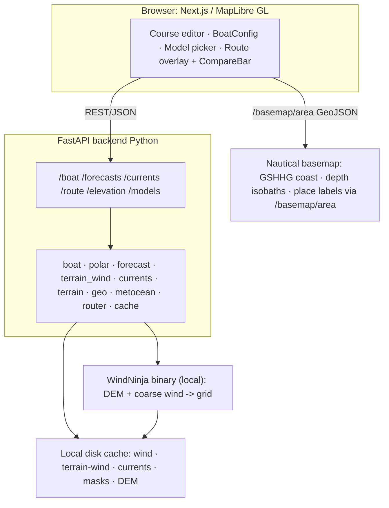

# Sailing Weather Router — v1 MVP Build Plan (Execution)

Local-first static route planner for **UK + Mediterranean** offshore racing. Given a configurable boat model, a hand-drawn race course, and one or more free European forecast models, compute a terrain- and current-aware isochrone route **per model**, overlay them in distinct colors on a terrain-and-depth-aware chart, and show a per-model ETA/waypoint table.

## Prime directives (non-negotiable)
- **Region lock:** UK + Mediterranean only. **No US systems, models, charts, or feeds** — no NOAA/NOMADS/GFS/HRRR, no NOAA ENC. Every connector is chosen for good UK + Med coverage and free access.
- **Scope lock:** Static planner only. Do NOT add live GPS/Signal K, delta-vs-plan, reroute-from-here, replay, consensus/robust routing, wave-penalty, fleet/AIS/YB, post-race calibration, accounts, payments, hosting, mobile-native, or nav-grade charting. All deferred items -> `// TODO(v2):`.
- **Local-first:** backend + frontend + all caches run on the user's laptop/onboard machine. Fetch forecasts/currents while connected (ashore/with signal), then route fully offline against the cache. FES gives tides with zero connectivity.
- **Simplicity rule:** when a design choice is ambiguous, prefer the simplest option that satisfies the AC and leave a `// TODO(v2):` marker.
- **Boundary rule:** the frontend NEVER parses GRIB/NetCDF or runs WindNinja. It requests routes and sampled fields as JSON. All metocean/terrain/current/routing math stays in Python.

## Locked technical decisions
- **Backend/router:** Python 3.11+ (FastAPI), NumPy for the router.
- **Frontend:** TypeScript + Next.js (React).
- **Map engine:** MapLibre GL JS (native terrain-RGB + hillshade + WebGL custom layers).
- **Deploy:** local-first (offline mid-race, no hosting).
- **Forecast connector:** Open-Meteo (primary, one endpoint/all EU models, no key) + optional native European GRIB (DWD/ECMWF/Meteo-France).
- **Forecast models:** ECMWF IFS, ICON + ICON-EU (DWD), ARPEGE + AROME (Meteo-France), UKMO.
- **Orographic wind:** WindNinja (open-source local CLI) + geometric heuristic fallback.
- **Currents/tides:** Copernicus Marine (MED + NW-Shelf/global SMOC) + FES2014/2022 harmonics for offline.
- **Terrain/elevation:** Copernicus DEM GLO-30 (terrain-RGB + point query).
- **Depth/bathymetry:** EMODnet Bathymetry (contours + grid).
- **Land mask:** GSHHG / Natural Earth coastline polygons (coarse, not nav-grade).
- **Multi-model UX:** route each model separately, overlay in distinct colors, **no aggregation** (PredictWind-style).
- Two runtimes (Python + Node) plus one native binary (WindNinja), all local.

## UI direction — PredictWind-inspired
Clean, modern marine routing UI:
- Dark chart canvas as the hero. Slim left control rail with collapsible sections: **Course editor**, **BoatConfig panel**, **Model picker**. Floating bottom **CompareBar** with color-swatched per-model rows.
- **Distinct color per model**, overlaid (never aggregated); consistent palette in `apps/web/src/lib/colors.ts` matching `ModelPreset.color`.
- Layer stack (bottom->top): in-house nautical basemap (GSHHG coastline + EMODnet/GEBCO depth isobaths 2–30 m + place/island labels) -> wind heatmap/arrows -> per-model route GeoJSON lines with tack/gybe/mark markers. Click -> elevation/depth readout.
- Crisp typography, subtle panels, tabular numerics in RouteTable/CompareBar, hover tooltips, smooth layer toggles, model color swatches everywhere.

## Step 0 — Git repo (runs first, in background)
- `git init`, add `.gitignore` (Python + Node), `LICENSE`, baseline `README.md`; initial commit.
- `gh repo create oliverkidd/sailing-router --private --source . --remote origin --push` (auth confirmed as `oliverkidd`, scopes include `repo`).
- Verify remote + first push; report repo URL back to the user.

## Architecture (spec §4)



## Repo structure (monorepo, spec §5)
```
sailing-router/
├─ README.md · Makefile · docker-compose.yml   # docker pins eccodes + WindNinja
├─ apps/web/                     # Next.js + TypeScript
│  └─ src/
│     ├─ components/  MapView · CourseEditor · BoatConfigPanel ·
│     │               ModelPicker · RouteTable · CompareBar · CurrentLayer
│     └─ lib/  api.ts · types.ts · colors.ts
├─ services/api/                 # FastAPI
│  └─ app/
│     ├─ main.py · schemas.py · config.py        # presets, connector cfg, params
│     ├─ boat.py · polar.py
│     ├─ forecast/  base.py · openmeteo.py · dwd_icon.py · ecmwf.py · meteofrance.py
│     ├─ terrain_wind/  base.py · windninja.py · heuristic.py
│     ├─ currents/  base.py · copernicus.py · fes.py
│     ├─ terrain.py · geo.py · metocean.py · router.py · cache.py
├─ packages/shared-schemas/       # OpenAPI → TS types
├─ data/  sample-polars/ · sample-courses/ · masks/ · dem/ · fixtures/
└─ docs/  this-plan.md
```

## Core data models (spec §6)
Define in `schemas.py` (pydantic); generate `apps/web/src/lib/types.ts` from the FastAPI OpenAPI schema.

```python
LatLon = tuple[float, float]     # (lat, lon), WGS84 degrees

class BoatConfig(BaseModel):
    polar_id: str
    tack_penalty_s: float = 30.0
    gybe_penalty_s: float = 20.0
    upwind_twa_deg: float | None = None      # target beat angle; else derived from polar VMG
    downwind_twa_deg: float | None = None     # target run/gybe angle
    leeway_coeff: float = 0.0                  # leeway_deg = coeff*TWS/max(bsp,eps)^2, capped
    leeway_max_deg: float = 8.0
    current_drift_factor: float = 1.0          # 1.0 = full current effect
    polar_efficiency: float = 1.0              # 0..1 real-world derate

class Course(BaseModel):
    start: LatLon; finish: LatLon
    marks: list[Mark]                          # ordered rounding marks
    exclusions: list[list[LatLon]]             # polygons to avoid
    depart_utc: datetime
    min_depth_m: float = 3.0

class ModelPreset(BaseModel):
    id: str          # "ecmwf" | "icon" | "icon_eu" | "arpege" | "arome" | "ukmo"
    label: str; resolution_deg: float
    connector: Literal["open-meteo","dwd","ecmwf-open","meteofrance"]
    color: str

class RouteRequest(BaseModel):
    course: Course
    boat: BoatConfig
    model_ids: list[str]                       # one route per model
    use_terrain_wind: bool = True
    use_currents: bool = True
    time_step_s: int = 300
    heading_step_deg: float = 7.5

class RouteLeg(BaseModel):
    t_utc: datetime; position: LatLon
    tws: float; twd: float; twa: float
    heading: float; bsp: float                 # boat speed through water
    sog: float; cog: float                     # over-ground after current + leeway
    cur_set_deg: float; cur_rate_kn: float
    maneuver: Literal["none","tack","gybe","mark"] = "none"

class ModelRoute(BaseModel):
    model_id: str; legs: list[RouteLeg]
    eta_utc: datetime; elapsed_s: int; distance_nm: float
    n_tacks: int; n_gybes: int; forecast_exhausted: bool

class RouteResponse(BaseModel):
    routes: list[ModelRoute]; warnings: list[str]
```

## Connector matrix (spec §3) — every dependency is pluggable behind a Python interface
- `ForecastProvider` — **Open-Meteo** (default; ECMWF/ICON/ICON-EU/ARPEGE/AROME/UKMO wind 10 m, free HTTP JSON, no key); optional native GRIB: **DWD Open Data** (ICON/ICON-EU), **ECMWF open-data** (IFS, `ecmwf-opendata`), **Meteo-France open data** (ARPEGE/AROME, token). Never NOAA/NOMADS.
- `TerrainWindModel` — **WindNinja** (local OSS binary, no data feed) + geometric heuristic fallback.
- `CurrentProvider` — **Copernicus Marine MED** (`MEDSEA_ANALYSISFORECAST_PHY_006_013`, incl. tides), **Copernicus SMOC/NW-Shelf** (`GLOBAL_ANALYSISFORECAST_PHY_001_024`, circulation + FES tidal + Stokes), **FES2014/2022** (offline harmonics, anywhere).
- `TerrainProvider` — **Copernicus DEM GLO-30** (elevation / terrain-RGB, pre-clipped).
- `DepthProvider` — **EMODnet Bathymetry** (depth grid + contours; Med + NW-Europe/UK) with **GEBCO** global fallback.
- `LandProvider` — **GSHHG** high-res coastlines (Natural Earth 110m fallback).
- Base chart: in-house MapLibre style via `/basemap/area` (coastline + depth isobaths + place/island labels). No third-party raster basemap.
- **Defaults:** Open-Meteo for all models; currents default to **Copernicus SMOC** (global, incl. tidal) with **FES** offline fallback; MED product when higher-res Med tidal detail wanted.
- Agent must **verify live endpoints/params at build time** and keep small European fixtures in `data/fixtures/` so tests never hit the network.

---

## Component specifications & acceptance criteria

### 7.1 Boat (`boat.py`) + Polar (`polar.py`)
- Polar CSV in ORC/Expedition format (row = TWS, col = TWA, cells = knots). `speedFor(tws,twa)`: clamp to axes, bilinear interpolation, **no-go -> 0** below upwind / above deep-run limits.
- `BoatConfig` drives the router: if `upwind_twa_deg`/`downwind_twa_deg` set, prefer those; else derive optimal beat/run angles from polar VMG per TWS.
- Apply `polar_efficiency` as a global BSP multiplier.
- Leeway: `leeway_deg = clamp(leeway_coeff * tws / max(bsp,eps)^2, 0, leeway_max_deg)`, shifting the boat's water-track downwind of heading; `leeway_coeff = 0` disables (default off; document tuning).
- **AC:** grid-point lookups exact; interpolation within tolerance; no-go returns 0; manual tack-angle override changes routed beat angle; leeway shifts track when enabled.

### 7.2 Forecast connectors (`forecast/`)
- `ForecastProvider.fetch(model_id, bbox, cycle, horizon) -> WindField` (canonical dims `(time,lat,lon)`, vars `u10,v10` m/s).
- `openmeteo.py` (default): one HTTP JSON client; map `model_ids` -> Open-Meteo `models=` (ecmwf_ifs, icon_global, icon_eu, meteofrance_arpege/arome, ukmo_*); request `wind_speed_10m` + `wind_direction_10m` on a small lat/lon grid over bbox; convert to `u10,v10`.
- Native GRIB (optional): `dwd_icon.py`, `ecmwf.py`, `meteofrance.py` — download only 10 m U/V for bbox, read with `cfgrib`/`xarray`. All European; no NOMADS/NOAA.
- Cache each `WindField` to NetCDF/zarr keyed by `(model_id, bbox_hash, cycle)`.
- **AC:** each preset returns a WindField over the requested horizon; golden test against a checked-in European fixture; agent verifies live endpoints at build time.

### 7.3 Orographic terrain wind (`terrain_wind/`) — the accuracy layer
- `TerrainWindModel.apply(wind_field, dem, options) -> WindField` (terrain-downscaled field).
- `windninja.py` (primary): WindNinja CLI subprocess. Inputs: DEM GeoTIFF (Copernicus DEM GLO-30) + coarse model wind per time step (domain-average or NWP init). **Mass-conserving** solver default (seconds/run); **mass+momentum** optional (better lee eddies). Enable **diurnal slope-flow + non-neutral stability** for **katabatic/anabatic** winds (needs date/time + lat/lon). Yields corner/headland speed-up, flow bending/channeling between islands, lee wind shadows. Parse output grids -> canonical `WindField`; cache keyed by `(model_id,bbox,cycle,solver,diurnal)`. Run once per forecast time step (batchable); ~0 correction over open water.
- `heuristic.py` (fallback, no binary): per-island leeward shadow polygon length `L~k*h` (peak height h) oriented downwind with decaying reduction, plus corner-acceleration bump near headland tips. For fast preview or missing binary.
- Selection: `use_terrain_wind` + `terrain_wind.engine` config (`windninja` | `heuristic` | `none`).
- **AC:** WindNinja shows lee reduction + windward/corner speed-up vs raw; diurnal on/off changes nearshore night winds; fallback plausible when binary absent; router output differs terrain on vs off.

### 7.4 Currents & tides (`currents/`)
- `CurrentProvider.fetch(bbox, window) -> CurrentField` (dims `(time,lat,lon)`, vars `u,v` m/s surface current).
- `copernicus.py` (default): `copernicusmarine` client (free token). MED -> `MEDSEA_ANALYSISFORECAST_PHY_006_013` (incl. tides, up to 15-min). UK/N-Atlantic -> global **SMOC** (`GLOBAL_ANALYSISFORECAST_PHY_001_024`) or NW-Shelf. Cache to NetCDF.
- `fes.py` (offline fallback): load FES2014/2022 harmonic constituents once; compute tidal `u,v` for any lat/lon/time fully offline — ideal for tide gates (Messina, Solent, Alderney Race).
- `CurrentField.currentAt(lat,lon,t) -> (u,v)` with bilinear + temporal interpolation.
- **AC:** convention test (direction/rate sane); MED product resolves a known tidal signal near a strait; FES computes nonzero tidal currents offline; interpolation tests.

### 7.5 Terrain / depth / land (`terrain.py`, `geo.py`)
- `elevation(lat,lon)` from pre-clipped Copernicus DEM (`rasterio`); serves hillshade + wind-shadow + `/elevation`.
- Land polygons (GSHHG / Natural Earth) -> `on_land`, `segment_crosses_land`.
- EMODnet depth grid -> `depth`, `too_shallow(...,min_depth_m)`; contours as GeoJSON for the map.
- Exclusion polygons -> `in_exclusion`.
- Geodesy: `destination`, `distance_nm`, `bearing` (document great-circle vs rhumb).
- **AC:** island-crossing leg rejected; 2 m point flagged at `min_depth_m=3`; exclusion membership correct.

### 7.6 Isochrone router (`router.py`) — terrain wind + current set-and-drift, one route per model
Run once per selected `model_id`, using that model's terrain-downscaled `WindField` and the shared `CurrentField`.

```
INPUT: course, boat(BoatConfig), wind_field(model, terrain-adjusted), current_field, constraints, params
STATE: frontier = [ Node(pos=start, t=depart, parent=None) ]

for each course leg (start→mark1→…→finish):
  target = next mark or finish
  loop:
    next = []
    for node in frontier:
      tws,twd = wind_field.windAt(node.pos, node.t)         # None → forecast exhausted
      cu,cv   = current_field.currentAt(node.pos, node.t) if use_currents else (0,0)
      for heading in range(0,360,heading_step_deg):
        twa = angle_between(heading, twd)                    # 0..180
        bsp = polar.speedFor(tws,twa) * boat.polar_efficiency
        if bsp<=0: continue                                 # no-go
        maneuver,pen = detect_maneuver(node, heading, twd, boat)
        course_thru_water = heading + leeway_offset(boat, tws, bsp, twd, heading)
        vx,vy = vector(course_thru_water, bsp)               # knots
        gx,gy = vx + kn(cu)*boat.current_drift_factor, vy + kn(cv)*boat.current_drift_factor
        eff_dt = max(0, time_step_s - pen)
        new_pos = advance(node.pos, (gx,gy), eff_dt)
        if on_land(new_pos) or segment_crosses_land(node.pos,new_pos): continue
        if too_shallow(new_pos, course.min_depth_m): continue
        if in_exclusion(new_pos): continue
        sog,cog = magnitude_bearing(gx,gy)
        next.append(Node(new_pos, node.t+time_step_s, parent=node, heading,bsp,
                         tws,twd,twa, sog,cog, cur_set,cur_rate, maneuver))
    next = prune(next, target)
    frontier = next
    if any node within target.radius: record arrival; break to next course leg
    if forecast exhausted for all nodes: set forecast_exhausted; stop
BACKTRACK parents from best finish node → list[RouteLeg]
```
- **Pruning (all three):** (1) bucket by bearing sector from target, keep max VMC/sector; (2) grid-cluster by lat/lon cell, keep best/cell; (3) cap frontier (~2-4k), keep highest-VMC.
- **Maneuvers:** compare tack (wind side) & point of sail parent->candidate; apply `tack_penalty_s`/`gybe_penalty_s`. If manual target angles set, bias headings upwind/downwind.
- **Mark rounding:** proximity within `radius_nm`; enforce side only if `rounding != "either"` (`// TODO(v2)` strict geometry).
- **AC:** constant wind/no current/no terrain -> expected VMG-tacking route + plausible ETA; currents on changes ETA/track (strong tidal gate shifts timing); terrain wind on/off changes route near islands; island between endpoints -> route goes around; two models -> two different routes; ~600 nm course at defaults completes < ~15 s incl. cached terrain wind.

### 7.7 Frontend
- **MapView:** in-house nautical basemap (GSHHG coastline + depth isobaths 2–30 m + place/island labels from `/basemap/area`); wind heatmap/arrows; one colored GeoJSON line per model with tack/gybe/mark markers; click -> elevation/depth.
- **BoatConfigPanel:** edit tack/gybe penalties, tack-angle overrides, leeway coeff, current-drift factor, polar-efficiency; upload polar.
- **ModelPicker:** checkbox list of 5-6 European presets with color swatches; toggles `use_terrain_wind`/`use_currents`; "Run".
- **CompareBar:** row per model — color, label, ETA (UTC + elapsed), distance, tacks/gybes, forecast-exhausted flag.
- **RouteTable:** per-model waypoint table incl. current set/rate and SOG/COG.
- **AC:** select 3 models -> 3 colored routes + 3 comparison rows; toggling terrain-wind/currents visibly changes routes; terrain relief, safe-water shading, current particles render.

## API contract (FastAPI, spec §8)
```
POST /boat             body: BoatConfig (+CSV)      → validated BoatConfig + polar_id
GET  /models           → list[ModelPreset]          (5-6 European presets + colors)
POST /forecasts/fetch  {model_ids,bbox,cycle?}      → per-model status + cache keys
POST /currents/fetch   {bbox,window,source}         → status + cache key
POST /route            RouteRequest                 → RouteResponse (one ModelRoute/model)
GET  /elevation?lat=&lon=                           → {elevation_m}
GET  /health
```
All UTC ISO-8601; positions `(lat,lon)`. `/route` fails fast with `warnings[]` if a model or currents aren't cached (frontend then calls the fetch endpoints).

## Build milestones (ordered — each passes its AC before the next)
- **M0 Scaffold:** monorepo, FastAPI `/health`, MapLibre map over UK+Med with nautical chart baseline, `make dev`, docker-compose pinning eccodes+WindNinja, install pnpm. *AC:* `make dev` up; map loads.
- **M1 Boat + Polar:** CSV -> `PolarTable`; `BoatConfig` with penalties/overrides/leeway/derate; polar diagram. *AC:* §7.1.
- **M2 Forecast (Open-Meteo):** ECMWF + ICON via Open-Meteo -> canonical `WindField`; `windAt`. *AC:* §7.2 vs EU fixture. **[GATE 1]**
- **M3 Geo + depth:** land + EMODnet depth + exclusions + geodesy; masks prebuilt for one race bbox. *AC:* §7.5.
- **M4 Router (single model, no terrain/current):** isochrone + pruning + penalties; `/route`; waypoint table. *AC:* §7.6 baseline. **[GATE 2]**
- **M5 Currents:** Copernicus SMOC + FES offline; set-and-drift + leeway; current particle flow. *AC:* §7.4 + currents change ETA.
- **M6 Orographic wind:** WindNinja (mass-conserving + diurnal) + heuristic fallback; wire into router + optional shadow render. *AC:* §7.3 + terrain changes route near islands. **[GATE 3]**
- **M7 Multi-model:** add ICON-EU/ARPEGE/AROME/UKMO; `/route` loops model_ids; ModelPicker + colored overlays + CompareBar. *AC:* 3 models -> 3 colored routes + table; toggles work.
- **M8 Polish + fixtures + docs:** sample courses (Aegean 600, Rolex Middle Sea, UK/RORC leg) + GeoJSON import/export; README "fetch ashore, race offline" + WindNinja/Copernicus setup. *AC:* cold checkout reproduces a multi-model, terrain+current route. **[GATE 4]**

## Self-review gates (I run these myself, no user approval — then continue)
At each `[GATE]` I stop, add explicit review todos, and: (1) run the milestone AC + tests, (2) re-read new code for correctness / simplicity / scope-lock (no US sources, `// TODO(v2)` markers present), (3) fix + clean up, (4) commit, then proceed.
- **GATE 1 (after M2):** connectors pluggable + region-locked, cache works, fixture test passes offline.
- **GATE 2 (after M4):** router baseline ACs (constant-wind VMG tacking, island avoidance, pruning bounded), performance sanity, property tests (no land/shallow/exclusion crossings).
- **GATE 3 (after M6):** terrain wind changes route near islands, heuristic fallback works without binary, currents change ETA, diurnal effect visible.
- **GATE 4 (after M8):** cold checkout reproduces a multi-model, terrain+current route; manual E2E checklist passes; full suite green.

## Testing & verification (spec §11)
- **Unit:** polar interpolation, leeway, wind convention, current set-and-drift vector math, geodesy, maneuver detection, pruning bounds.
- **Golden/fixture:** checked-in small European GRIB/JSON + DEM + depth + FES -> deterministic route snapshots; ETA within tolerance.
- **Property:** no route leg crosses land / below `min_depth_m` / inside exclusion.
- **Terrain sanity:** WindNinja lee reduction + windward speed-up vs raw field on a test island.
- **Currents sanity:** strong tidal gate shifts optimal timing.
- **Performance:** default ~600 nm route within budget; frontier bounded.
- **Convention pinning:** TWD "from" direction; TWA port/starboard sign; knots vs m/s; current "toward" (set).
- **Manual E2E checklist (docs):** sample polar -> draw Aegean 600 -> pick ECMWF+ICON+UKMO, terrain+currents on -> 3 colored routes + table.

## Risks & guardrails (spec §12)
- **WindNinja integration:** C++ binary + DEM prep + per-timestep runs; pin via Docker, keep heuristic fallback so router always runs. OSS software, not a US data feed — no region-lock conflict.
- **GRIB toolchain:** `eccodes`/`cfgrib` native deps fiddly — Open-Meteo default avoids them; native GRIB optional.
- **Copernicus token:** free account required; FES offline fallback keeps routing possible without it.
- **Endpoint drift:** everything behind connector interfaces; European fixtures for offline tests.
- **Model resolution near islands:** even ICON-EU/AROME under-resolve micro-effects; WindNinja + manual exclusions compensate; surface model resolution in the UI.
- **Not nav-grade:** label depth/land/currents advisory; cross-check real nav software.
- **Scope creep:** anything in §13 is out — add `// TODO(v2)`.

## v2+ backlog (deferred — do NOT build)
Live position (Signal K/GPS) · delta-vs-plan + XTE · reroute-from-here with hysteresis · replay · consensus/robust route across models · wave-penalty modeling · strict mark-rounding geometry · fleet overlay (AIS/YB) · observed-performance/forecast-bias learning · auto polar calibration · accounts/cloud sync/hosting · mobile-native/PWA · commercial charts · licensed high-res models.

## Getting started (human, from README)
```bash
# backend
cd services/api && python -m venv .venv && source .venv/bin/activate
pip install -e .   # fastapi uvicorn xarray cfgrib rasterio shapely numpy pydantic
                   #  ecmwf-opendata copernicusmarine pyfes(or equiv)
# WindNinja: install binary (or use docker-compose which pins it)
uvicorn app.main:app --reload
# frontend
cd apps/web && pnpm install && pnpm dev
# offline fixtures
make fetch-fixtures   # small EU GRIB/JSON + DEM + depth + FES clips
```
Local-first workflow: **ashore/with signal** -> pick models -> `/forecasts/fetch` + `/currents/fetch` (cache to disk) -> **offshore/offline** -> draw/adjust course + boat config -> `/route` runs entirely against the cache (FES gives tides with zero connectivity).

## Deliverable
A private `sailing-router` repo where a cold checkout runs `make dev`, fetches EU forecasts/currents ashore, and computes multi-model terrain+current isochrone routes offline, rendered PredictWind-style with a per-model comparison table.
